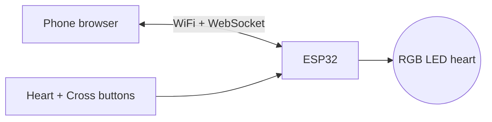
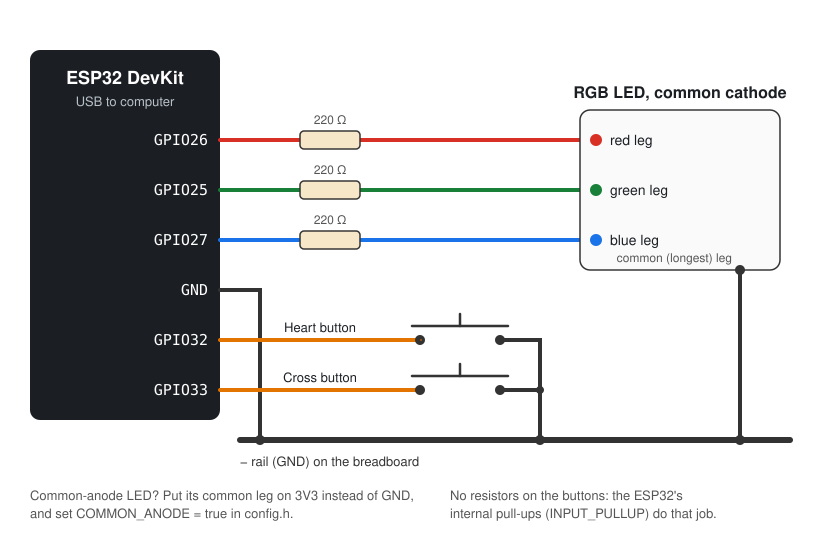

# Heart Doll

A doll whose heart glows when someone far away is there for you. An ESP32 inside, one RGB LED for the heart, a **Heart** and a **Cross** button, and a phone app for the other person, served by the doll itself over WiFi. No app to install.

Built as the prototype for DM2601 at KTH, exploring pre-sleep rituals for people who have moved abroad. See the [repo overview](../README.md).

<!-- When the demo GIF is ready, replace this comment with:

-->

## Features

- **Two people, one heart.** The doll person presses Heart when they're available; the phone person taps their circle. Each person's availability is their own until they change it.
- **A heart you can read at a glance:** slow red breathing when the doll person is waiting, a lub-dub heartbeat at 60% when the phone person is there, 100% when you both are.
- **"Not now":** Cross darkens the doll without switching the other person off. Asking again clears it.
- **A phone app that fills:** two people joined to a heart by pipes that draw themselves; the heart fills like a container, half for each person, and glows and beats when it's full.
- **Always in sync:** the doll holds the one true state. Pages opened late, reloaded, or on two phones at once all show the same thing.
- **Clear feedback:** a white flash for every button press, a blue blink while the doll is offline, "Doll offline" on the phone. Both reconnect by themselves.
- **Easy address:** `http://heartdoll.local`, or the IP printed in Serial Monitor.

## How it works



The ESP32 joins your WiFi, serves the phone app, and keeps a live WebSocket open to every phone: requests come in, status and button events go out. The rules are one function (`nextState()`) that never touches the LED or the network; everything else (buttons, LED patterns, the phone link) is a separate module around it. See [architecture](docs/architecture.md) and the [protocol](docs/protocol.md) for details.

| State | Doll person | Phone person | LED |
|---|---|---|---|
| Idle | – | – | Off |
| Waiting | available | – | Slow breathing |
| Connected | hasn't answered | available | Heartbeat, 60% |
| Declined | "not now" | available | Off |
| Together | available | available | Heartbeat, 100% |

## What you need

| Part | Notes |
|---|---|
| ESP32 dev board (DevKit V1 / WROOM-32) | |
| 4-pin RGB LED | Common cathode, or common anode with one setting changed |
| 3 × 220 Ω resistors | One per colour leg; 150–470 Ω works |
| 2 × tactile pushbuttons | Heart and Cross |
| Breadboard, jumper wires, micro-USB data cable | |
| A 2.4 GHz WiFi network and a phone | A phone hotspot works |

Full parts list, including what's planned for later: [`hardware/bom.md`](hardware/bom.md).



<!-- When the wiring photo is ready, add:

-->

## Build and upload

1. Install **Arduino IDE 2**, the **esp32** board package by Espressif (**3.x**), and the libraries **ESP Async WebServer** and **Async TCP** (both by ESP32Async).
2. Wire it as above.
3. In `firmware/heart_doll/`, copy `secrets.example.h` to `secrets.h` and fill in your WiFi name and password. `secrets.h` is ignored by git.
4. Open `firmware/heart_doll/heart_doll.ino`, choose **ESP32 Dev Module** (or **DOIT ESP32 DEVKIT V1**), and upload.
5. Open Serial Monitor at **115200 baud** and watch the start-up colour check: red, green, blue. If the colours don't match the names printed, swap `PIN_RED` / `PIN_GREEN` / `PIN_BLUE` in [`config.h`](firmware/heart_doll/config.h). For a common-anode LED, set `COMMON_ANODE = true`.

New to this? The **[step-by-step build guide](docs/guide/README.md)** starts from testing each part on its own.

Compile-checked with Arduino IDE 2.3.10, esp32 3.3.12, Async TCP 3.5.0 and ESP Async WebServer 3.12.1.

## How to use it

1. Power the ESP32 over USB. After the colour check, the LED blinks blue until it joins WiFi.
2. Serial Monitor prints the address. On a phone on the same network, open **http://heartdoll.local** or the printed IP.
3. **On the doll:** press **Heart** when you're available (the LED breathes), **Cross** for "not now" (the LED goes dark). Every press flashes white.
4. **On the phone:** tap your circle (bottom) to become available or step away. The heart fills from your side, and from theirs when they press Heart.
5. Both available: the heart on the phone is full and beating, and the doll's heartbeat is at full brightness.

No phone handy? Type `a` (available) or `u` (unavailable) in Serial Monitor to play the phone.

<!-- When screenshots are ready, add:
 
-->

## Project structure

```
firmware/heart_doll/   the firmware (open heart_doll.ino in Arduino IDE)
firmware/tests/        four small sketches for bringing up and debugging the hardware
hardware/              parts list and wiring diagram
docs/                  build guide, architecture, protocol, story, build log, gotchas
```

Inside `firmware/heart_doll/`:

| File | Job |
|---|---|
| `heart_doll.ino` | Turns inputs into events, applies the rules, carries out the effects |
| `state_machine.h` | The rules, and nothing else |
| `led.h` | Draws the light patterns |
| `buttons.h` | Debounced button presses |
| `app_link.h` | WiFi, the web server and the WebSocket |
| `web_page.h` | The phone app (HTML, CSS, JavaScript) |
| `config.h` | Every setting: pins, timings, brightness |
| `secrets.example.h` | Template for `secrets.h` (your WiFi details) |

## Documentation

- **[Build guide](docs/guide/README.md):** the prototype in four phases, from testing parts to the liquid-heart app.
- **[The story of the build](docs/story.md):** context, decisions, and what changed along the way.
- **[Architecture](docs/architecture.md)** and the **[doll ↔ phone protocol](docs/protocol.md)**.
- **[Gotchas](docs/gotchas.md):** pitfalls worth knowing before you start.
- **[Build log](docs/build-log.md):** what happened in each phase.
- **[Test sketches](firmware/tests/README.md):** what each one checks and when to use it.

## Versions

| Version | What's new |
|---|---|
| v1.1 | Liquid-heart phone app; heartbeat at 60% / 100%; Cross means "not now" (Declined) |
| v1.0 | Phone app over WiFi and WebSocket; Together state; start-up colour check; offline blink |
| v0.5 | The state machine, with Serial Monitor standing in for the phone |
| v0.1 | Hardware tests: LED, patterns, buttons, WiFi |

## Roadmap

Planned, not built yet:

| Version | Phase |
|---|---|
| v1.2 | A heartbeat you can feel: DRV2605L haptic driver and an LRA motor |
| v1.3 | Music and voice: DFPlayer Mini, heartbeat sound, chime, a recorded goodnight, quiet hours |
| v1.4 | Robustness: reconnects under stress, an optional Waiting timeout, a stress test |
| v1.5 | Into the doll: perfboard, a diffused LED, strain relief |
| v2.0 | Cloud relay over MQTT, so the phone works from anywhere |
| v2.1 | Battery and a power switch |

## License

The code is MIT; see [`LICENSE`](../LICENSE). Documentation and images are [CC BY 4.0](../LICENSE-CC-BY-4.0.txt).
