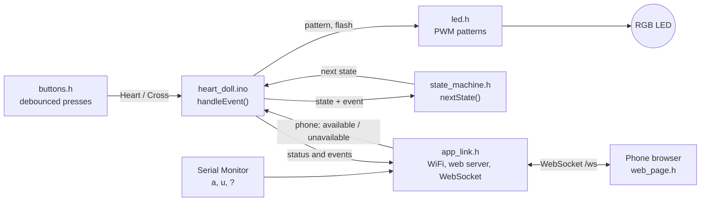
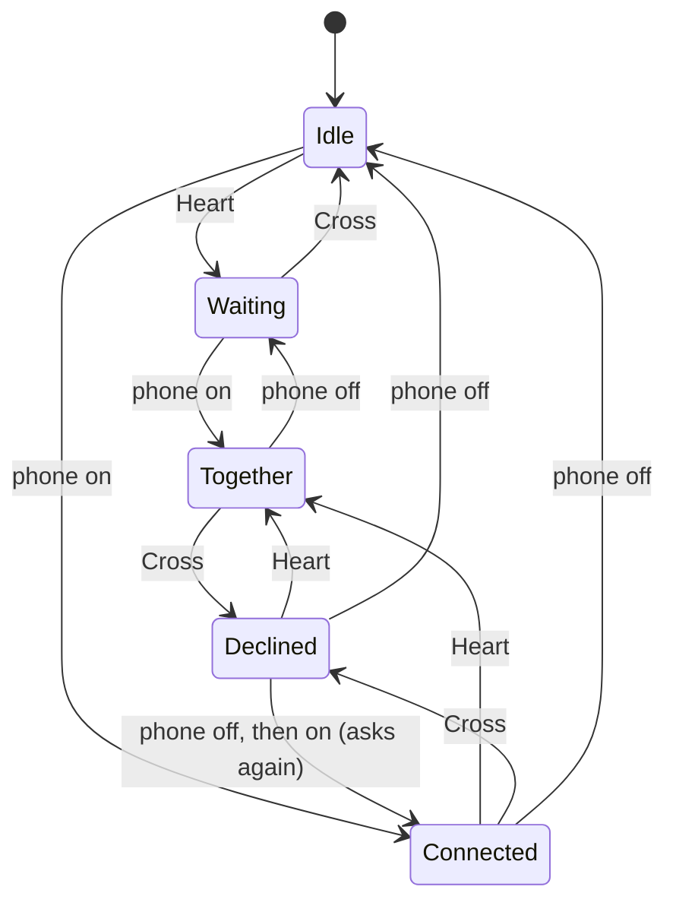

# Architecture

How the firmware and the phone app fit together, and why they're built this way.

## The big picture



Each file is one module with one job. They're `.h` tabs in a single Arduino sketch, included at the top of `heart_doll.ino`, so everything they define exists before the Arduino IDE generates its function prototypes.

| File | Job | Knows about |
|---|---|---|
| `heart_doll.ino` | Turns inputs into events, asks the rules for the next state, carries out the effects | All modules |
| `state_machine.h` | The rules: `(state, event) → next state`. Nothing else | States and events. No LED, buttons or network |
| `led.h` | Draws a pattern on the RGB LED with PWM: off, breathing, heartbeat at two strengths, flash, no-WiFi blink | `config.h` |
| `buttons.h` | `buttonPressed()`: true exactly once per press | `config.h` |
| `app_link.h` | Joins WiFi, serves the page, keeps a WebSocket to every phone, and lets the Serial Monitor play the phone | `state_machine.h` (event numbers) |
| `web_page.h` | The phone app: HTML, CSS and JavaScript in one raw string, stored in flash | The message protocol |
| `config.h` | Every pin, timing and pattern setting in one place | — |
| `secrets.h` | Your WiFi name and password. Not in the repo; copy `secrets.example.h` | — |

Two decisions carry most of the design:

- **Rules apart from effects.** `nextState()` only decides. It never touches the LED or sends anything, so the whole rulebook fits on one screen and can be checked against the table below. When the phone arrived in Phase 3, the rules didn't change at all.
- **The ESP32 is the single source of truth.** The phone never assumes anything. Tapping your circle sends a request; the picture only changes when the doll answers with its new status. The LED and the app can't disagree, and two phones stay in sync.

## The state machine

Two people, each available or not, plus one answer: the doll person can say "not now" to the phone person. That gives five states.

| State | Doll person | Phone person | LED | Phone app |
|---|---|---|---|---|
| `idle` | not available | not available | Off | Empty heart |
| `waiting` | available (Heart) | not available | Slow red breathing, 4 s per breath, 40% peak | Top pipe drawn, drops fill the heart to half |
| `connected` | hasn't answered | available | Red lub-dub heartbeat, 60 BPM, at 60% | Bottom pipe drawn, heart half full from below |
| `declined` | said "not now" (Cross) | available | Off | Same as `connected`: "not now" looks like not available |
| `together` | available | available | The same heartbeat at 100% | Both pipes, heart full, glowing and beating |



The complete rulebook, as `nextState()` implements it:

| Now in ↓ / event → | Heart | Cross | Phone: on | Phone: off |
|---|---|---|---|---|
| Idle | Waiting | Idle | Connected | Idle |
| Waiting | Waiting | Idle | Together | Waiting |
| Connected | Together | Declined | Connected | Idle |
| Declined | Together | Declined | Connected | Idle |
| Together | Together | Declined | Together | Waiting |

The rules behind the table:

- **Each person's availability is their own** and stays until they change it. Neither side can switch the other off.
- **Cross means "not now".** The doll goes dark, but the phone person stays available.
- **Asking again clears "not now".** If the phone person taps off and on again, the doll shows the 60% heartbeat again.
- **Every button press counts,** even when the state doesn't change: it flashes the LED and sends `event:heart` or `event:cross`.

## One event at a time

```cpp
void handleEvent(DollEvent event) {
  DollState before = state;
  DollState after  = nextState(before, event);   // the rules decide
  // ... log it, flash and send event:heart / event:cross for button presses ...
  if (after != before) {
    state = after;
    showState(state);   // one LED pattern per state
    sendStatus();       // "status:<name>" to every phone
  }
}
```

Every input ends up in `handleEvent()`: a button, a phone, or a letter typed in Serial Monitor. Nothing else changes the state.

## Two tasks, one decision-maker

The web server runs on its own background task, not in `loop()`. So the WebSocket handler never acts on a message: it only parks the request in `appPendingEvent`, and `loop()` collects it through `appLinkReadEvent()` and passes it to `handleEvent()`, as for any other input. A short critical section (`portENTER_CRITICAL` / `portEXIT_CRITICAL`) stops the two tasks touching the shared values at the same instant. If two requests arrive before `loop()` looks, the latest wins.

## A loop that never waits

```cpp
void loop() {
  unsigned long now = millis();
  if (buttonPressed(BUTTON_HEART, now)) handleEvent(EVENT_HEART);
  if (buttonPressed(BUTTON_CROSS, now)) handleEvent(EVENT_CROSS);
  int fromPhone = appLinkReadEvent();
  if (fromPhone >= 0) handleEvent((DollEvent)fromPhone);
  appLinkUpdate(now);
  ledSetNoWifi(!appLinkOnline());
  ledUpdate(now);
}
```

There's no `delay()` anywhere after start-up. Every light pattern is a function of the clock: `ledUpdate()` asks `millis()` what time it is and sets the brightness for that instant, 100 times a second. So a heartbeat never blocks a button press or a phone message, and switching patterns mid-beat never glitches.

## The LED

`ledUpdate()` decides what to show by priority:

1. **The acknowledgement flash:** white for 150 ms after a button press.
2. **No WiFi:** a short blue blink every 2 s while the doll is offline. Blue never means anything else.
3. **The pattern for the current state.**

Brightness goes through gamma correction (the level is squared) so fades look even to the eye. That's why "60%" means 60% as the eye sees it, about 36% of the LED's power. The heartbeat is two bell-shaped bumps: a strong "lub" at 120 ms and a softer "dub" at 360 ms, over a faint floor.

## The phone app

`web_page.h` is one page: an SVG of two people joined to a heart by squiggly pipes. Three ideas carry it:

- **Trim path.** Each pipe is drawn twice, a faint track and a red copy. The red copy's dash is as long as the path; sliding it (`stroke-dashoffset`) makes the line draw itself.
- **The heart as a container.** The liquid is a rectangle with a wavy top, clipped to the heart's outline. Each person fills half. The heart is wider at the top, so a small lookup table turns "half the area" into the right height (59%).
- **One animation loop, only while moving.** A single `requestAnimationFrame` loop moves the pipes, the liquid, the ripple and falling drops, and stops when everything is still. Phones set to reduce motion skip the animations but show every state.

Once both are available and the liquid reaches the top, a CSS lub-dub at 1 s per beat matches the doll.

## Settings

Everything you might tune is in `config.h`, with units in the names (`_MS` = milliseconds) and safe ranges in the comments: pins, `COMMON_ANODE`, breath and beat timing, the 60% and 100% heartbeat levels, debounce, the start-up colour check and the hostname. Animation timing and colours for the app are constants at the top of the script and CSS in `web_page.h`.
