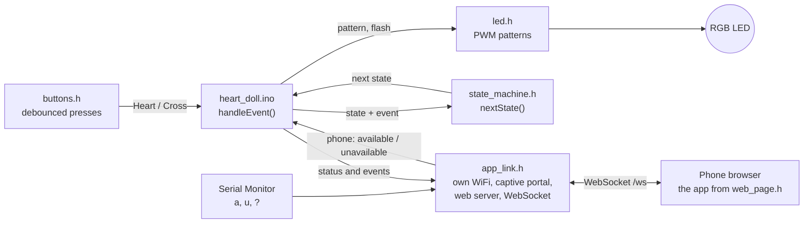
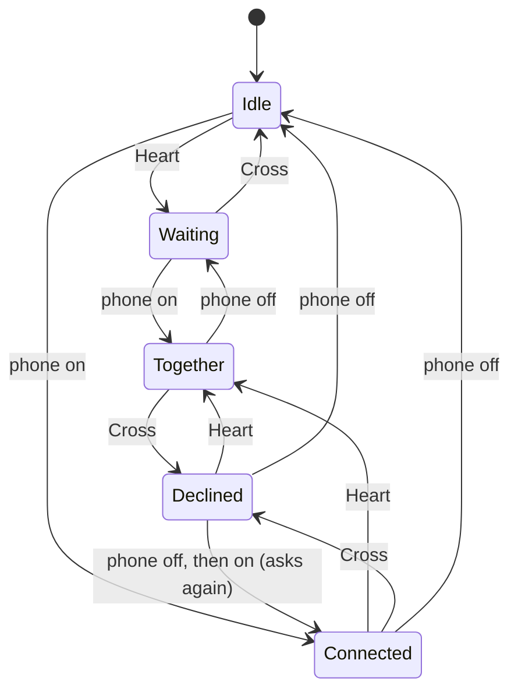

# Architecture

How the firmware and the phone app fit together, and why they're built this way.

## The big picture



Each file is one module with one job. They're `.h` tabs in a single Arduino sketch, included at the top of `heart_doll.ino`, so everything they define exists before the Arduino IDE generates its function prototypes.

| File | Job | Knows about |
|---|---|---|
| `heart_doll.ino` | Turns inputs into events, asks the rules for the next state, carries out the effects | All modules |
| `state_machine.h` | The rules: `(state, event) → next state`. Nothing else | States and events. No LED, buttons or network |
| `led.h` | Draws a pattern on the RGB LED with PWM: off, breathing, heartbeat at two strengths, flash, no-phone blink | `config.h` |
| `buttons.h` | `buttonPressed()`: true exactly once per press | `config.h` |
| `app_link.h` | Makes the doll's WiFi (or joins yours), runs the captive portal, serves the app, keeps a WebSocket to one phone, and lets the Serial Monitor play the phone | `state_machine.h` (event numbers) |
| `web_page.h` | The phone app: the React app from [`app/`](../app), one gzip-compressed file in flash. Generated | The message protocol |
| `config.h` | Every pin, timing and pattern setting in one place | — |
| `secrets.h` | Your WiFi name and password. Not in the repo; copy `secrets.example.h` | — |

Two decisions carry most of the design:

- **Rules apart from effects.** `nextState()` only decides. It never touches the LED or sends anything, so the whole rulebook fits on one screen and can be checked against the table below. When the phone arrived in Phase 3, the rules didn't change at all.
- **The ESP32 is the single source of truth.** The phone never assumes anything. Tapping your circle sends a request; the picture only changes when the doll answers with its new status. The LED and the app can't disagree, and two phones stay in sync.

## The state machine

Two people, each available or not, plus one answer: the doll person can say "not now" to the phone person. That gives five states.

| State | Doll person | Phone person | LED | Phone app |
|---|---|---|---|---|
| `idle` | not available | not available | Off | Empty heart |
| `waiting` | available (Heart) | not available | Slow red breathing, 4 s per breath, 40% peak | Top pipe drawn, drops fill the heart to half |
| `connected` | hasn't answered | available | Red lub-dub heartbeat, 60 BPM, at 60% | Bottom pipe drawn, heart half full from below |
| `declined` | said "not now" (Cross) | available | Off | Same as `connected`: "not now" looks like not available |
| `together` | available | available | The same heartbeat at 100% | Both pipes, heart full, glowing and beating |



The complete rulebook, as `nextState()` implements it:

| Now in ↓ / event → | Heart | Cross | Phone: on | Phone: off |
|---|---|---|---|---|
| Idle | Waiting | Idle | Connected | Idle |
| Waiting | Waiting | Idle | Together | Waiting |
| Connected | Together | Declined | Connected | Idle |
| Declined | Together | Declined | Connected | Idle |
| Together | Together | Declined | Together | Waiting |

The rules behind the table:

- **Each person's availability is their own** and stays until they change it. Neither side can switch the other off.
- **Cross means "not now".** The doll goes dark, but the phone person stays available.
- **Asking again clears "not now".** If the phone person taps off and on again, the doll shows the 60% heartbeat again.
- **Every button press counts,** even when the state doesn't change: it flashes the LED and sends `event:heart` or `event:cross`.

## One event at a time

```cpp
void handleEvent(DollEvent event) {
  DollState before = state;
  DollState after  = nextState(before, event);   // the rules decide
  // ... log it, flash and send event:heart / event:cross for button presses ...
  if (after != before) {
    state = after;
    showState(state);   // one LED pattern per state
    sendStatus();       // "status:<name>" to every phone
  }
}
```

Every input ends up in `handleEvent()`: a button, a phone, or a letter typed in Serial Monitor. Nothing else changes the state.

## Two tasks, one decision-maker

The web server runs on its own background task, not in `loop()`. So the WebSocket handler never acts on a message: it only parks the request in `appPendingEvent`, and `loop()` collects it through `appLinkReadEvent()` and passes it to `handleEvent()`, as for any other input. A short critical section (`portENTER_CRITICAL` / `portEXIT_CRITICAL`) stops the two tasks touching the shared values at the same instant. If two requests arrive before `loop()` looks, the latest wins.

## A loop that never waits

```cpp
void loop() {
  unsigned long now = millis();
  if (buttonPressed(BUTTON_HEART, now)) handleEvent(EVENT_HEART);
  if (buttonPressed(BUTTON_CROSS, now)) handleEvent(EVENT_CROSS);
  int fromPhone = appLinkReadEvent();
  if (fromPhone >= 0) handleEvent((DollEvent)fromPhone);
  appLinkUpdate(now);
  checkPhone(now);           // blue blink with no phone; a minute gone = stepped away
  ledUpdate(now);
}
```

There's no `delay()` anywhere after start-up. Every light pattern is a function of the clock: `ledUpdate()` asks `millis()` what time it is and sets the brightness for that instant, 100 times a second. So a heartbeat never blocks a button press or a phone message, and switching patterns mid-beat never glitches.

## The LED

`ledUpdate()` decides what to show by priority:

1. **The acknowledgement flash:** white for 150 ms after a button press.
2. **No phone:** a short blue blink every 2 s while no phone has the app open (in hotspot mode, also while the doll can't join WiFi). In between, the state's pattern still shows, so the doll person sees their own breathing. Blue never means anything else.
3. **The pattern for the current state.**

Brightness goes through gamma correction (the level is squared) so fades look even to the eye. That's why "60%" means 60% as the eye sees it, about 36% of the LED's power. The heartbeat is two bell-shaped bumps: a strong "lub" at 120 ms and a softer "dub" at 360 ms, over a faint floor.

## The phone app

The app is a React and React Three Fiber project in [`app/`](../app); its [README](../app/README.md) has the details. Three ideas carry it:

- **One number per person.** Each person's liquid is a single value from 0 to 2: 0 to 1 is liquid travelling down their tube, 1 to 2 is their half of the heart filling. Joining moves it up, leaving moves it back down, so the tube always fills before the heart and drains after it.
- **Liquid that stays level.** The liquid is the heart's inner shape, cut off by a shader at a surface that stays level with the world as the phone tilts, sloshing on a pair of springs.
- **The doll decides.** The app only sends requests and draws the status the doll reports, as before. A `DollLink` interface hides where the doll is: the real doll's WebSocket, or a simulated doll that runs the same rules for the demo.

For the doll, `npm run build:doll` builds the app into one HTML file (scripts, styles, font and photo inside), compresses it with gzip, and writes it into `web_page.h` as bytes. The doll sends them unchanged with `Content-Encoding: gzip`, and the phone unpacks them. At about 490 KB it needs the **Huge APP** partition scheme.

## The doll's own network

With `WIFI_MODE = WIFI_OWN_NETWORK`, `app_link.h` makes the doll an access point at `192.168.4.1`:

- **One phone.** `WiFi.softAP()` takes the most phones allowed to join (`MAX_PHONES`), and `esp_wifi_set_inactive_time()` drops a phone that has gone quiet (`WIFI_IDLE_DROP_S`), so a phone that walks away frees its place.
- **A captive portal.** A small DNS server answers every name with the doll, and the web server answers the phone's "am I online?" checks with a redirect to the app, until the app has opened. The [protocol](protocol.md#reaching-the-doll) lists the checks.
- **One app connection.** The WebSocket keeps a short list of accepted connections. A new one from the same phone replaces the old (a reload); one from anyone else gets `link:busy`.
- **A phone that vanishes.** Switching WiFi off doesn't always close the app's connection: the phone just stops answering. So the doll pings a quiet connection every `PHONE_PING_S` and closes it after `PHONE_SILENT_S` without an answer, and on its own network it closes every app connection as soon as no phone is left on its WiFi.
- **Has the phone gone?** `checkPhone()` in `heart_doll.ino` blinks blue while no phone has the app open, and `showState()` then draws the state as if the phone person had stepped away (it asks `nextState()` what that would be), so the doll never beats for a phone that isn't there. The state itself is kept, so a reload or a locked screen picks up where it left off. If the phone person is still available after `PHONE_GONE_MS` with no phone, it sends the phone's "unavailable" through `handleEvent()`, like any other input.

## Settings

Everything you might tune is in `config.h`, with units in the names (`_MS` = milliseconds) and safe ranges in the comments: pins, `COMMON_ANODE`, breath and beat timing, the 60% and 100% heartbeat levels, debounce, the start-up colour check, the hostname, the WiFi mode, the phone limit and the timeouts. The app's timing and colours live in [`app/src`](../app/src).
