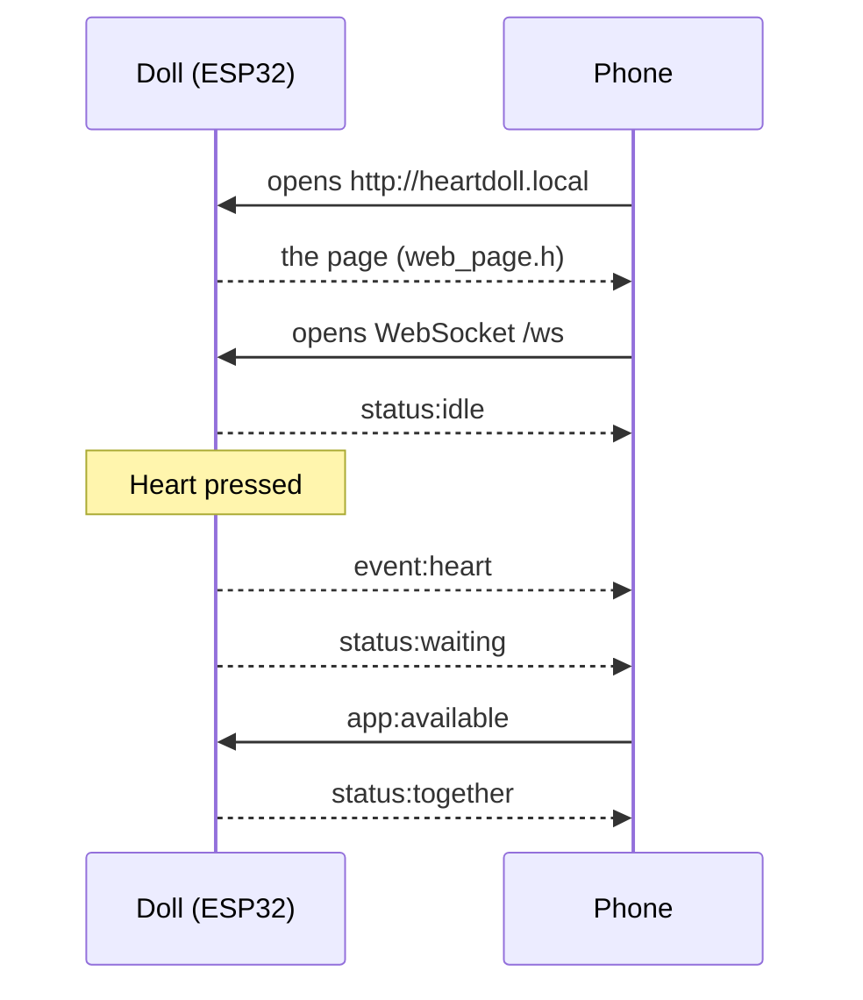

# Phase 3: The phone app

**Goal:** the doll joins WiFi, serves its own web app, and both user flows work between a phone and the doll, live, in both directions.

**Code:** [`firmware/heart_doll`](../../firmware/heart_doll): `app_link.h`, `web_page.h`, `secrets.example.h`

No wiring changes.

## The idea

- **A WebSocket.** A normal web request is one question and one answer. A WebSocket stays open, so either side can speak at any moment. That's what lets a button press on the doll appear on the phone instantly, without the phone asking.
- **Status and events.** A **status** (`status:waiting`) describes the situation now; the doll remembers the last one and sends it to every phone that connects, even late. An **event** (`event:heart`) is a moment; it's sent once, to the phones open at the time. Full list: [protocol](../protocol.md).
- **Two tasks, one decision-maker.** Network messages arrive on a background task, not in `loop()`. The handler only *parks* a request; `loop()` collects it and passes it to `handleEvent()`, like any other input.

```cpp
// On the network task: park the request, don't act on it.
portENTER_CRITICAL(&appLinkLock);
appPendingEvent = event;
portEXIT_CRITICAL(&appLinkLock);
```



`app_link.h` keeps the functions the rest of the firmware already used (`appLinkBegin`, `appLinkSend`, `appLinkReadEvent`) and adds two: `appLinkUpdate()` for WiFi housekeeping and `appLinkOnline()` for the blue no-WiFi blink. That's why `heart_doll.ino` barely changed when the phone arrived.

The page itself lives in `web_page.h` as a C++ raw string, `R"rawliteral( ... )rawliteral"`, so the HTML needs no escaping, stored in flash with `PROGMEM`.

## Steps

1. Check both libraries from Test D are installed: **ESP Async WebServer** and **Async TCP**, by ESP32Async.
2. In `firmware/heart_doll/`, copy `secrets.example.h` to `secrets.h` and fill in your 2.4 GHz network, as in Test D. `secrets.h` is ignored by git.
3. Turn on the hotspot, upload, and open Serial Monitor.
4. After the colour check, wait for the address:

```
=== Heart Doll v1.1 - liquid heart ===
Colour check (if the LED doesn't match, swap PIN_RED / PIN_GREEN / PIN_BLUE in config.h):
  now: RED
  now: GREEN
  now: BLUE
Joining WiFi: <your network>
Phone page: open the address printed when WiFi connects.
You can still play the phone here:  a = available,  u = unavailable,  ? = help

    -> phone: status:idle
WiFi: connected
Open on your phone:  http://172.20.10.3
or:                  http://heartdoll.local
Phone connected. Phones open: 1
```

5. Open that address on your phone, on the same network.

> **How it was first built.** v1.0's page showed the two people side by side with "I'm available" / "I'm unavailable" buttons, and had four states: both being available showed as a calmer 40 BPM heartbeat. Phase 4 replaced both. This phase is also where the LED turned out to glow **green** instead of red: its red and green legs were swapped, which is why `config.h` now has `PIN_RED = 26` and runs a colour check at every start-up.

## What to check

- [ ] While the doll joins WiFi, the LED blinks blue briefly every 2 s; the blinking stops once connected.
- [ ] The page loads and the dot at the top right says **Connected**.
- [ ] A button press on the doll changes the page within a fraction of a second, and a tap on the page changes the LED.
- [ ] Reloading the page shows the right state at once.
- [ ] Turning the hotspot off: the doll blinks blue and the page says "Doll offline". Turning it back on: both recover by themselves.

## If something's wrong

| Symptom | Likely cause and fix |
|---|---|
| Blue blinking forever, no `WiFi: connected` | Network name or password in `secrets.h`, hotspot off, or 5 GHz. Rerun Test D |
| `secrets.h not found` note while compiling | Expected until you copy `secrets.example.h` to `secrets.h` |
| Page doesn't load | The phone isn't on the same network, or it's the hotspot phone itself. Use the IP address, or a second device |
| Page stuck on "Connecting…" | Check the address starts with `http://`, not `https://`. Reload |
| Errors inside the web server library | An old look-alike library. Keep only the ESP32Async versions |

**Next:** [Phase 4, a heart that fills](04-heart-that-fills.md).
